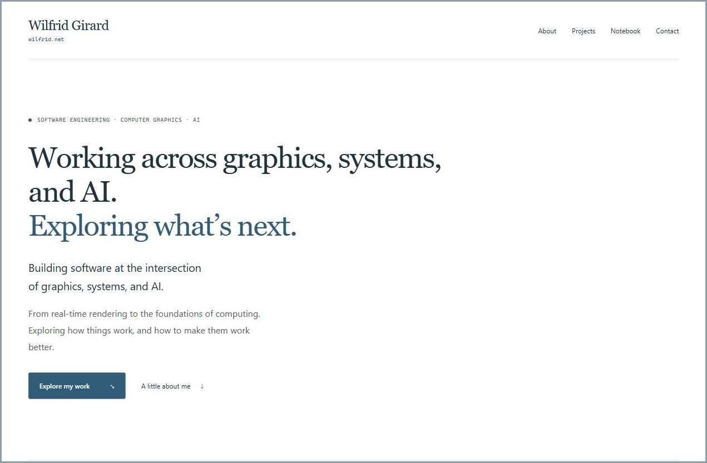

# wilfrid.net

The personal website of **Wilfrid Girard**, a software engineer with around 20 years of experience in real-time graphics and performance-focused systems. My work at Unity and Silicon Studio spans graphics technology, console platforms, and rendering research. I’m now exploring GPU computing, machine learning, and AI infrastructure.

[LinkedIn](https://www.linkedin.com/in/wilfrid) · [GitHub](https://github.com/wilfrid-labs) · [Book a conversation](https://calendly.com/wilfrid-girard)

<a href="https://wilfrid.net"></a>

## About this repository

This site brings together my background, selected projects, and contact links, with space for future writing and interactive experiments.

Built with **Astro, TypeScript, and plain CSS**, it reflects a preference for simple, fast, maintainable software:

- Prerendered HTML, with a small client script only for the optional email interaction.
- Semantic markup, visible keyboard focus, responsive layouts, and reduced-motion support.
- System fonts and local artwork, with no analytics or tracking.

## Run locally

Use Node.js 24 LTS (compatible with the minimum in `package.json`), then on Windows:

```sh
npm.cmd ci
npm.cmd run dev -- --background
```

Run `npm.cmd run check` for Astro and TypeScript diagnostics, and `npm.cmd run build` to generate the production output locally. Configure optional `CONTACT_EMAIL` in an ignored `.env` file. See the [maintenance guide](docs/maintenance.md#local-development) for server controls and setup details.

## CI and deployment

PRs to `main` run validation; merging triggers Cloudflare Workers deployment. CI publishes no staging site. See the [contribution workflow](CONTRIBUTING.md) and [deployment operations](docs/maintenance.md#github-actions-deployment).

Before the first deployment, complete the [initial setup checklist](docs/first-deployment.md).

## Project notes

- [Architecture](docs/architecture.md) — technical choices and visual design.
- [Maintenance](docs/maintenance.md) — editing, local development, email configuration, and deployment details.
- [Contributing](CONTRIBUTING.md) — feature branches, PR review, validation, and merging.
- [Security](SECURITY.md) — deployment trust, credential handling, and remaining risks.
- [Todo](TODO.md) — outstanding work and ideas.
- [Change log](docs/changelog.md) — brief project history.
